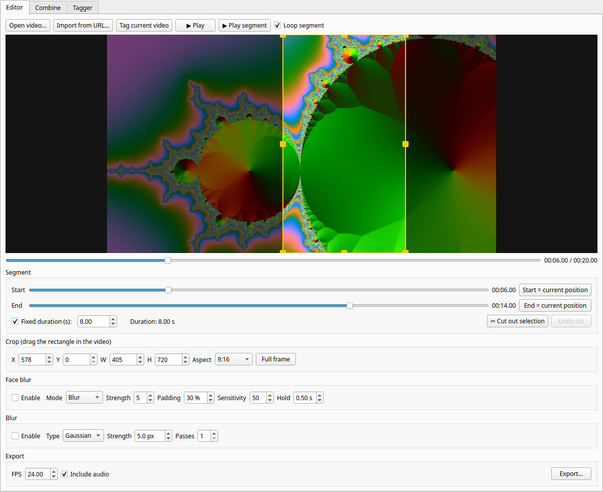
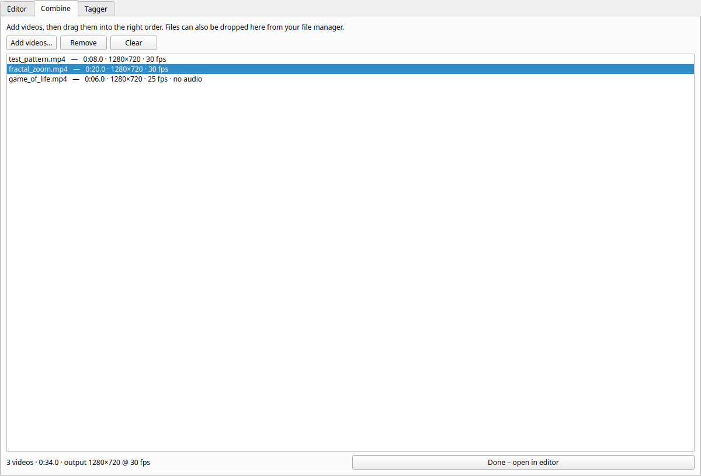
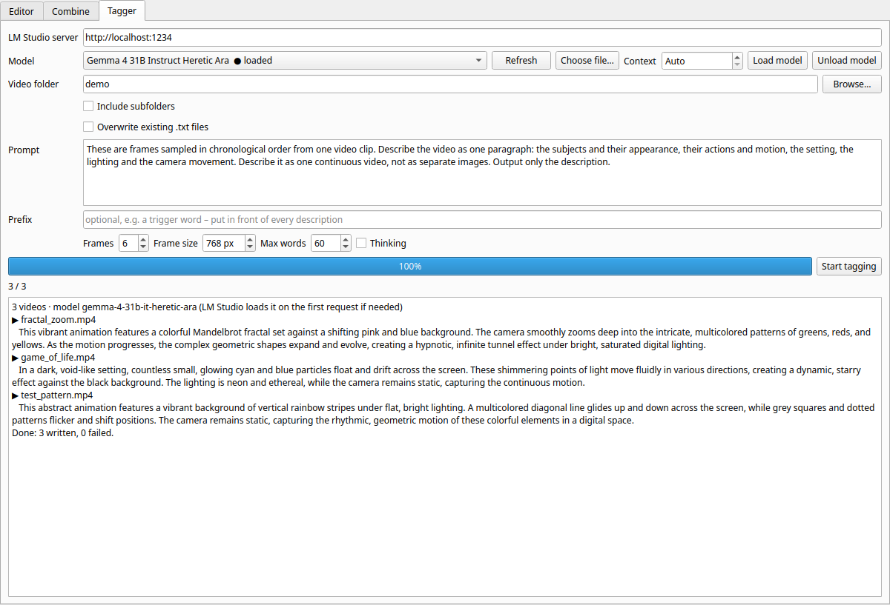

# Video Editor

A small desktop video editor for Linux, written in Python (PySide6 + ffmpeg).
It is built for quickly turning raw footage into short, cropped clips, and for
captioning video datasets with a local vision model in LM Studio.



## Features

### Editor
- **Open a video** (Ctrl+O), **import from a URL** (Ctrl+U) via yt-dlp from
  thousands of sites, or open a file directly: `./start.sh video.mp4`.
- **Segment selection** with Start and End sliders.
  - Dragging the playhead moves the segment start along.
  - Dragging End moves Start along, so the segment keeps its length.
  - **Fixed duration**: lock the segment to e.g. 15 seconds; both sliders move together.
  - Play or loop just the segment.
- **Cut out selection**: remove the selected part and join what comes before
  and after it. Repeat as often as you like. **Undo cut** (Ctrl+Z) goes back step by step.
- **Crop**: drag or resize a rectangle in the video, or type X/Y/W/H.
  Lock the **aspect ratio** to 16:9, 9:16 (Shorts/Reels/TikTok), 1:1, 4:5,
  4:3, 3:4, 21:9 or the original.
- **Face blur**: automatic face detection (OpenCV YuNet) with blur or pixelate,
  adjustable strength, padding, sensitivity and hold time. During export, faces
  are tracked over time, so brief detection misses stay covered.
- **Blur**: Gaussian or box blur of the whole frame, with strength and passes.
- **Live preview** of crop, face blur and blur.
- **Export** to MP4/MKV/MOV (H.264 + AAC) with an adjustable frame rate
  (default 24 fps), with or without audio, with a progress bar and cancel button.
- **Tag current video** (Ctrl+T): write a description of the loaded video to a `.txt` file.

### Combine


- Add several videos (button, or drag files/folders in from your file manager).
- Drag them into the right order, then **Done** joins them and opens the result in the editor.
- Videos with a different size, frame rate or aspect ratio are scaled and
  letterboxed to match the first video. Clips without audio get silence.

### Tagger


Writes a description of every video in a folder to a `.txt` file with the same
name (`clip.mp4` → `clip.txt`), for example to caption a training dataset.

- Uses a **vision model in LM Studio**. The model list is read from LM Studio,
  or pick a `.gguf` file with **Choose file…**.
- **Context** length (default 40K): the model is (re)loaded with exactly this
  context. **Load model** / **Unload model** buttons manage GPU memory.
- Editable **prompt**, optional **prefix** (e.g. a trigger word), number of
  **frames** per video, **frame size**, **max words** per description, and an
  optional **thinking** mode for reasoning models.
- Skips videos that already have a `.txt` file, unless you choose to overwrite.
  Can include subfolders.

### General
- All settings, folders, the window size and the last tab are **remembered
  between sessions** (`~/.config/videoedit/videoedit.conf`).
- Temporary files from cutting and combining are cleaned up on exit.

## Requirements

- Linux (developed on Ubuntu)
- Python 3.10 or newer
- ffmpeg and ffprobe on your `PATH` (`sudo apt install ffmpeg`)
- Optional, for the tagger: [LM Studio](https://lmstudio.ai) with the local
  server enabled and a vision-capable model downloaded

Python packages (installed automatically by `start.sh`): PySide6, Pillow,
OpenCV (headless), yt-dlp. The face detection model (YuNet, about 230 KB) is
downloaded to `models/` the first time face blur is enabled.

## Getting started

```bash
git clone <this repository> videoedit
cd videoedit
./start.sh
```

The first run creates a virtual environment in `.venv` and installs the dependencies.

### Add it to the Ubuntu app menu and dock

```bash
cat > ~/.local/share/applications/videoedit.desktop <<EOF
[Desktop Entry]
Type=Application
Name=Video Editor
Comment=Cut, crop, blur and combine videos
Exec=$PWD/start.sh %f
Icon=$PWD/icon.svg
Terminal=false
Categories=AudioVideo;Video;AudioVideoEditing;
MimeType=video/mp4;video/quicktime;video/x-matroska;video/webm;video/x-msvideo;
StartupWMClass=videoedit
EOF
```

Then press Super, search for **Video Editor**, right-click it and choose
**Add to Favorites**. Videos can also be opened with *Open With → Video Editor*.

## Tips

- **yt-dlp stops working for a site?** Update it: `.venv/bin/pip install -U yt-dlp`.
- **Face blur** is automatic and never 100% guaranteed. Check the export
  before sharing it. If a face is missed briefly, raise **Hold** or **Padding**.
  If something that is not a face gets blurred, lower **Sensitivity**.
- **Tagger and GPU memory**: a smaller context uses less memory. Unload other
  models in LM Studio if two large models don't fit at the same time.
- Models only roughly follow a word count. The tagger asks for 75–100% of
  **Max words**, lets the model shorten an answer that is too long, and trims
  to whole sentences as a last resort.

## Project layout

| File | Contents |
|------|----------|
| `videoedit.py` | Main window, editor tab, export, cut/undo, settings |
| `combine.py` | Combine tab |
| `tagger.py` | Tagger tab and LM Studio integration |
| `faceblur.py` | Face detection, tracking and blurring |
| `start.sh` | Creates the virtual environment on first run and starts the app |
| `icon.svg` | App icon |
